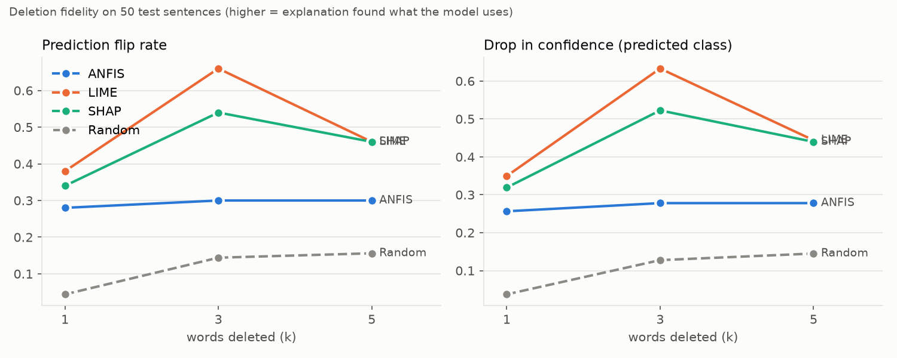
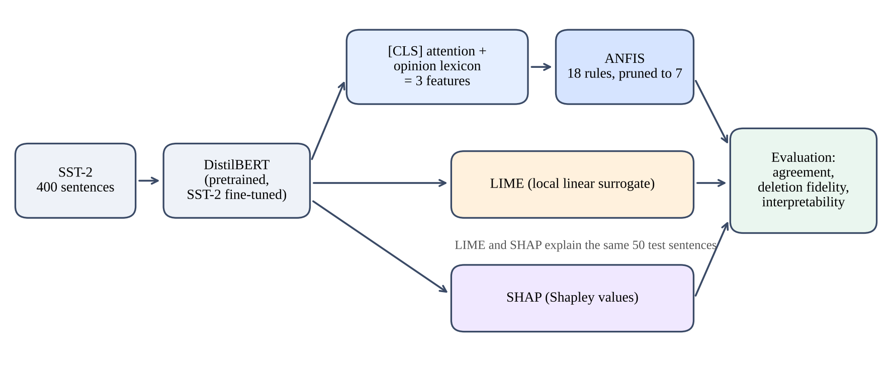
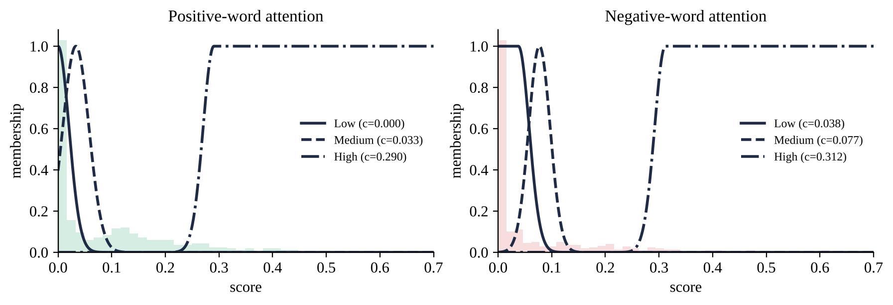

# Can Fuzzy Rules Explain Text Classifiers Better Than LIME and SHAP?

   

A hand-written **ANFIS** (Adaptive Neuro-Fuzzy Inference System) learns a small set of human-readable IF-THEN rules that explain a pretrained **DistilBERT** sentiment classifier. The rules are then compared head-to-head with **LIME** and **SHAP** on the same predictions, for fidelity and interpretability.

Instead of a list of word scores like

```
charming +0.41, affecting +0.22, journey +0.06, often -0.04 ...
```

the fuzzy system gives a reason:

```
IF positive-word attention is HIGH AND negative-word attention is LOW AND there is no negation
THEN sentiment is POSITIVE
```

Final project for **EEE1004 Neural Networks and Fuzzy Systems**, Punjab Engineering College (Deemed to be University), Chandigarh, under the guidance of Dr. Hemant Kumar.

---

## Key results

| | ANFIS (7 rules) | LIME | SHAP |
|---|---|---|---|
| Agreement with DistilBERT | 0.688 (held-out, n = 80) | 0.96 (local surrogate) | 1.00 (exact by construction) |
| Prediction flips when top word deleted | 0.28 (random: 0.044) | 0.38 | 0.34 |
| Flips per word actually deleted (k = 1) | 0.33 | 0.35 | 0.33 |
| Items to read per explanation | 3 conditions | 5 word scores | about 20 word scores |
| Distinct explanations over 50 sentences | 7 | 50 | 50 |
| Explanation cost on CPU | near-instant | about 14 s per sentence | about 7 s per sentence |

**In short:** seven readable rules reproduce DistilBERT on 68.8% of unseen sentences, on par with a logistic regression on the same inputs (67.5%), while summarising the whole classifier in a few lines. LIME and SHAP match individual predictions more closely but produce a different explanation for every sentence. Per deleted word, the evidence ANFIS points to is as decisive for the classifier as SHAP's. All three word-level methods struggle with negation ("not bad").

<p align="center">
  
</p>

## How it works

<p align="center">
  
</p>

1. **Classifier.** `distilbert-base-uncased-finetuned-sst-2-english` labels 400 sentences from the SST-2 validation set (91.25% accuracy against gold labels).
2. **Attention features.** For each sentence, the final-layer [CLS] attention is averaged across heads and merged back into whole words. Three features are computed:
   - `pos_score`: attention on words in the Hu & Liu (2004) positive lexicon
   - `neg_score`: attention on words in the negative lexicon
   - `negation`: whether a negation word (not, no, never, n't, ...) is present

   Model confidence is saved for analysis only and is never fed to ANFIS, because it would leak the answer.
3. **ANFIS.** A first-order Takagi-Sugeno fuzzy system written from scratch in PyTorch. Each score gets Low / Medium / High fuzzy sets (Gaussian with shoulders), negation is Absent / Present, giving an 18-rule grid trained by gradient descent (Adam, binary cross-entropy) to mimic DistilBERT's labels.
4. **Pruning to 7 rules.** Rules are ranked by how much of the training data they describe (mean normalised firing strength). The top 6 are kept, then a coverage check adds the best rule needed so that every fuzzy label appears at least once (here, a rule for *negation Present*).
5. **Baselines.** LIME (500 perturbations) and SHAP (300 evaluations) explain the same 50 held-out sentences.
6. **Evaluation.** Agreement with the classifier, deletion fidelity (delete the top-k evidence words and see whether the prediction flips) against a random baseline, and interpretability proxies.

## The learned rules

| Rule | IF positive-word attention | AND negative-word attention | AND negation | THEN | Decides (test) | Agrees |
|---|---|---|---|---|---|---|
| R1 | High | Low | Absent | POSITIVE (0.95) | 9 | 100% |
| R2 | Low | Low | Absent | NEGATIVE (0.22) | 11 | 64% |
| R3 | Medium | Low | Absent | POSITIVE (0.93) | 22 | 77% |
| R4 | High | Medium | Absent | POSITIVE (0.79) | 4 | 50% |
| R5 | Low | High | Absent | NEGATIVE (0.00) | 12 | 67% |
| R6 | Low | Medium | Absent | NEGATIVE (0.10) | 3 | 100% |
| R7 | Low | Low | Present | NEGATIVE (0.25) | 19 | 47% |

R7 has the lowest agreement: the system knows a negation is present but not what it negates, so "not bad" is read as negative.

<p align="center">
  
</p>

## Quick start

Requires Python 3 and a normal CPU (no GPU needed).

```bash
python -m venv .venv
# Windows: .venv\Scripts\activate    macOS/Linux: source .venv/bin/activate
pip install torch==2.15.0 --index-url https://download.pytorch.org/whl/cpu
pip install -r requirements.txt
```

Run the pipeline in order (each step reads the previous step's outputs from `results/`):

```bash
python features.py     # DistilBERT + attention features      -> results/features.csv        (~1-2 min)
python anfis.py        # train and prune the fuzzy system      -> results/anfis_rules.txt     (< 1 min)
python baselines.py    # LIME and SHAP on 50 test sentences    -> results/lime.json, shap.json (~17 min)
python compare.py      # metrics, tables and charts            -> results/comparison.csv, *.png
python app.py          # interactive demo at http://127.0.0.1:7860
```

`python test_cases.py` runs 24 hand-written edge cases (negation, sarcasm, contrast, very short and very long inputs) through the same pipeline as the demo.

## The demo

`app.py` launches a Gradio page: type a sentence and see

- DistilBERT's prediction and confidence
- the three ANFIS inputs and their Low / Medium / High memberships
- the **deciding rule** (the rule contributing most to the final answer) as an IF-THEN sentence, plus the top 3 rules by firing strength
- warnings when no rule matches well, when the sentence has no sentiment words, or when it is longer than 128 tokens

## Project structure

```
.
├── features.py          # DistilBERT inference and attention-based features
├── anfis.py             # ANFIS model, training, coverage-aware pruning, rule printing
├── baselines.py         # LIME and SHAP explanations
├── compare.py           # agreement, deletion fidelity, interpretability, charts
├── app.py               # Gradio demo
├── test_cases.py        # edge-case tests
├── requirements.txt
├── results/             # outputs: features, rules, metrics, explanations, charts
└── docs/
    ├── ICNLP_Project_Report.pdf
    └── figures/
```

## Limitations

- **Word-level only.** Negation scope, sarcasm and mixed sentiment are not captured, and the same is true of LIME and SHAP.
- **Lexicon dependent.** 10% of sentences contain no lexicon word; for these ANFIS falls back to a weak default (R2).
- **Fuzzy set gaps.** The learned sets are narrow, leaving a range of medium scores with low membership in every set.
- **Small evaluation.** 80 held-out sentences for ANFIS and 50 for the three-way comparison; one sentence is worth 1.25 points of fidelity.
- **Attention as a signal** is itself debated (Jain & Wallace, 2019; Wiegreffe & Pinter, 2019).
- Interpretability is measured with proxies (rules, conditions, items to read), not a user study.

## Future work

- Features for negation scope, intensifiers ("very", "slightly") and contrast ("but")
- Keeping neighbouring fuzzy sets overlapping during training
- Local fuzzy rules per neighbourhood for a like-for-like comparison with LIME
- Larger test sets, cross-validation, other tasks and models, and a user study
- Applications such as explainable song recommendations from lyrics and reviews, content moderation and customer feedback triage

## Report

The full project report (methodology, analysis of every rule, project log and references) is in [`docs/ICNLP_Project_Report.pdf`](docs/ICNLP_Project_Report.pdf).

## References

- Jang, J.-S. R. (1993). ANFIS: Adaptive-network-based fuzzy inference system. *IEEE Transactions on Systems, Man, and Cybernetics, 23*(3), 665-685.
- Ribeiro, M. T., Singh, S., & Guestrin, C. (2016). "Why should I trust you?": Explaining the predictions of any classifier. *KDD 2016*, 1135-1144.
- Lundberg, S. M., & Lee, S.-I. (2017). A unified approach to interpreting model predictions. *NeurIPS 30*, 4765-4774.
- Sanh, V., Debut, L., Chaumond, J., & Wolf, T. (2019). DistilBERT, a distilled version of BERT. arXiv:1910.01108.
- Hu, M., & Liu, B. (2004). Mining and summarizing customer reviews. *KDD 2004*, 168-177.
- Socher, R., et al. (2013). Recursive deep models for semantic compositionality over a sentiment treebank. *EMNLP 2013*, 1631-1642.

## Author

**Dushyant Singh Taggar** (SID 23104077)
EEE1004 Neural Networks and Fuzzy Systems, Punjab Engineering College (Deemed to be University), Chandigarh
Guided by Dr. Hemant Kumar
